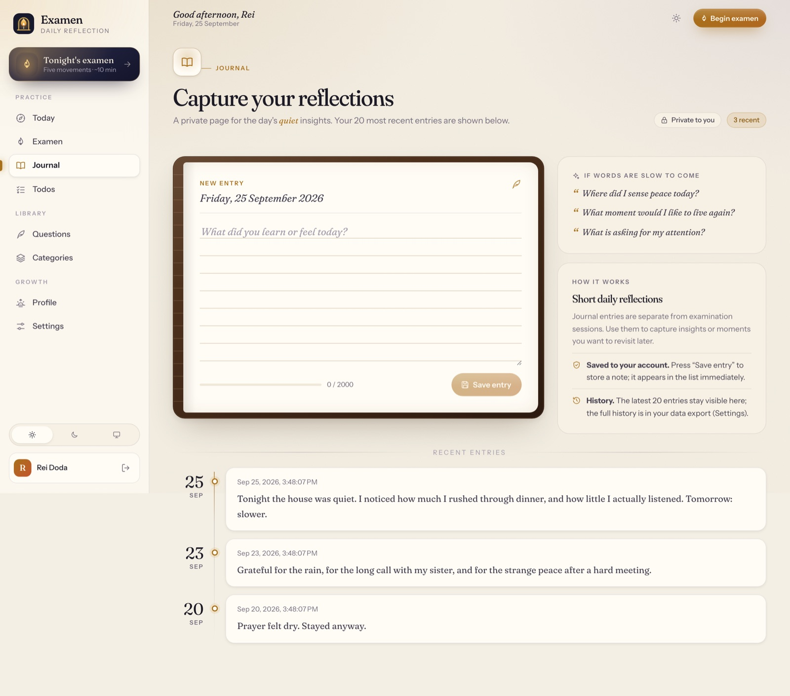

# ExAMEN

A daily reflection app for reviewing your day, writing a private journal, and building habits.

[Open the demo](https://kokutbon.github.io/ExAMEN/) · [Technical documentation](docs/DEPLOYMENT.md)

## Features

- Follow a guided daily reflection.
- Keep journal entries, gratitude notes, habits, and tasks.
- Explore personal trends in light or dark mode.

## Screenshots




## Technology

Angular, Java / Spring Boot, PostgreSQL, Docker.

## Run the demo locally

```sh
git clone https://github.com/KOKUTBON/ExAMEN.git
cd ExAMEN
cd examen-frontend
npm ci
npm run build:demo
npm run preview:demo
```

Open http://127.0.0.1:4300/ExAMEN/. The browser demo uses sample data. See the technical documentation for the full application setup.

## License

[MIT License](LICENSE).
