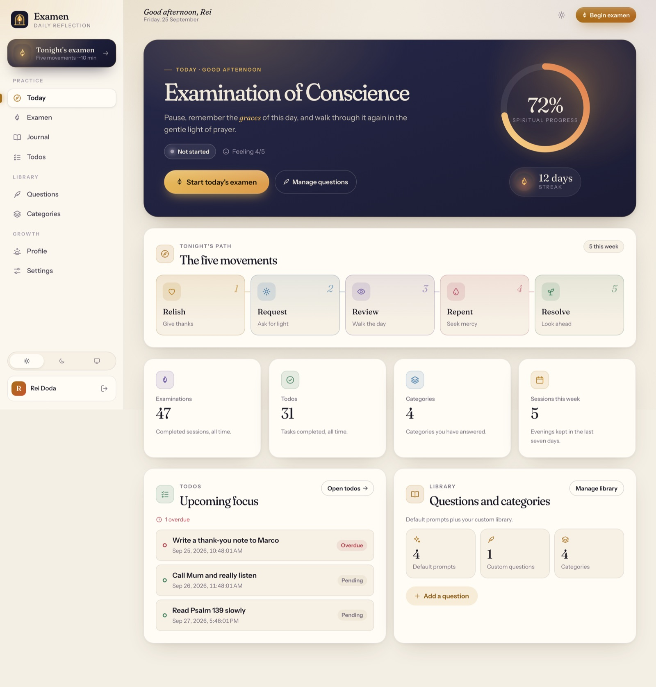

<p align="center">
  
</p>

<p align="center">A self-hosted daily reflection and journaling app for thoughtful review, gratitude, and next steps.</p>

<p align="center">
  
</p>

# ExAMEN

ExAMEN helps you build a quiet, repeatable practice of reviewing the day while keeping your data in infrastructure you control. It is open source under the MIT License and designed to run on a private server or local Docker host.

## Features

- Guided five-movement daily examen: Relish, Request, Review, Repent, and Resolve.
- Private journal entries, gratitude notes, mood and feeling scores, habits, todos, and custom prompts.
- Profile trends, growth summaries, and JSON/PDF export.
- Account password reset, account deletion, JWT authentication, ownership checks, and reset-request rate limiting.
- Angular SSR frontend, Spring Boot REST API, PostgreSQL persistence, and Flyway migrations.
- Optional Gemini-powered insights. Disabled by default; when disabled, insights use local deterministic fallbacks.
- Accessible responsive UI with light and dark themes.

## Quick start

Requirements: Docker Engine with Compose v2. Java 25+ and Node.js 20+ are only needed for local development.

```bash
git clone https://github.com/KOKUTBON/ExAMEN.git
cd ExAMEN
cp .env.example .env
export APP_JWT_SECRET="$(openssl rand -base64 48)"
docker compose up --build
```

Open <http://localhost:4001>. The API is available at <http://localhost:8080>; health is exposed at `/actuator/health`.

The example Compose settings are for local development only. Before exposing ExAMEN publicly, set unique database credentials, a strong JWT secret, HTTPS, a restricted CORS allow-list, and production SMTP settings. See [Deployment](docs/DEPLOYMENT.md).

## GitHub Pages demo

A separate client-only build is ready for `https://kokutbon.github.io/ExAMEN/`. It uses synthetic sample data stored in the visitor's browser, with no backend, account, email, or AI-provider calls. The self-hosted build keeps SSR.

```bash
cd examen-frontend
npm ci
npm run build:demo
npm run preview:demo
```

Open <http://127.0.0.1:4300/ExAMEN/>. Publishing is manual; pushing changes only builds and tests the demo. See [Demo setup and publishing](docs/DEMO.md).

## Privacy and optional AI

Your reflections are stored in the PostgreSQL database configured for this deployment. The repository contains only synthetic fixtures and screenshots; it does not include user accounts, journal exports, personal documents, analytics data, reset tokens, or API credentials.

Gemini is an opt-in integration, not a requirement. It is disabled unless `APP_GEMINI_ENABLED=true` and `APP_GEMINI_API_KEY` are explicitly configured. When enabled, selected reflection context is sent to Google's Gemini API for processing. Do not enable it if your privacy requirements prohibit sending reflection text to an external provider, and disclose the integration to your users. With Gemini disabled or unconfigured, the application uses local fallback insights and makes no AI-provider calls.

Email delivery is also optional. Password reset links are sent through the configured SMTP server; without SMTP, the development fallback writes the link to the backend log for operator-assisted recovery. Do not use that fallback in a shared production environment.

## Spiritual origin and use cases

ExAMEN is inspired by the Ignatian daily examen: a short practice of noticing gratitude, asking for clarity, reviewing the day honestly, receiving shortcomings with mercy, and choosing a concrete next step. The same structure can support prayer, mindfulness, recovery work, values-based reflection, or a secular evening review.

## Architecture

```text
Browser ── Angular SSR frontend ── REST/JWT ── Spring Boot API ── PostgreSQL
                                                   ├─ Flyway migrations
                                                   ├─ optional SMTP
                                                   └─ optional Gemini API
```

See [Architecture](docs/ARCHITECTURE.md) for runtime boundaries and data flow.

## Configuration

All runtime configuration is supplied through environment variables. Start with [`.env.example`](.env.example), and never commit a real `.env` file or credential.

| Variable | Purpose | Default |
| --- | --- | --- |
| `APP_JWT_SECRET` | JWT signing secret; at least 32 UTF-8 bytes | Required |
| `APP_CORS_ALLOWED_ORIGINS` | Comma-separated browser origins | Localhost origins |
| `APP_PUBLIC_URL` | Public web origin used in links and metadata | `http://localhost:4001` |
| `APP_PASSWORD_RESET_MAIL_ENABLED` | Enable password-reset mail delivery | `true` |
| `SPRING_MAIL_HOST` / `SPRING_MAIL_*` | SMTP delivery settings | Empty / local fallback |
| `APP_REMINDER_ENABLED` | Enable scheduled reminders | `true` |
| `APP_GEMINI_ENABLED` | Opt in to cloud Gemini insights | `false` |
| `APP_GEMINI_API_KEY` | Gemini credential, only used when enabled | Empty |
| `APP_GEMINI_MODEL` | Gemini model name | `gemini-2.5-flash` |

## Development and validation

Backend tests, including integration and security tests:

```bash
cd examen-backend
./gradlew clean test --no-daemon
```

Frontend type checks, unit tests, and SSR build:

```bash
cd examen-frontend
npm ci
npm run typecheck
npm test -- --watch=false
npm run build
```

Fixture-backed browser tests:

```bash
cd examen-frontend
npm run e2e:install
npm run e2e
```

For the complete validation matrix, Docker checks, migrations, and backup rehearsal, see [Testing](docs/TESTING.md).

## Documentation

- [Architecture](docs/ARCHITECTURE.md)
- [Privacy](docs/PRIVACY.md)
- [Deployment](docs/DEPLOYMENT.md)
- [Security policy](SECURITY.md)
- [API and configuration notes](docs/API.md)
- [Testing](docs/TESTING.md)
- [Contributing](CONTRIBUTING.md)
- [Code of Conduct](CODE_OF_CONDUCT.md)
- [Changelog](CHANGELOG.md)

## Contributing

Please read [CONTRIBUTING.md](CONTRIBUTING.md) before opening a pull request. Use synthetic accounts and reflection text in tests, demos, screenshots, and issue reports.

## License

ExAMEN is released under the [MIT License](LICENSE).

## KOKUTBON community and support

Open technology for the benefit of humankind — built by people, for people, and freely reusable by everyone.

Read [Contributing](CONTRIBUTING.md), [Code of Conduct](CODE_OF_CONDUCT.md), [Support](SUPPORT.md), [Governance](GOVERNANCE.md) and [Security](SECURITY.md). Help sustain the work through [GitHub Sponsors and other contributions](SPONSORSHIP.md). Maintainer release requirements are documented in [Release checklist](RELEASE_CHECKLIST.md).

## Source publication

See [source publication status](SOURCE_PUBLICATION.md) and [local validation record](PUBLICATION_VALIDATION.md) for the initial distribution and remaining release checks.

> **Demo hosting:** GitHub Pages has not been published. Any `kokutbon.github.io` URL above is planned; use the local preview instructions until deployment is verified.
