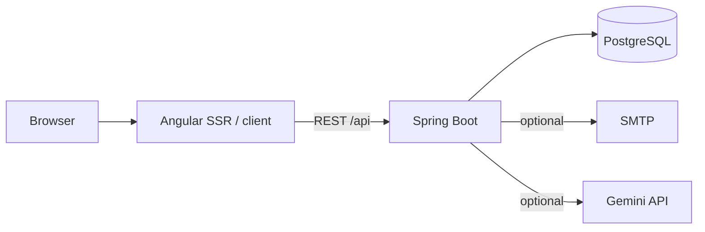

# Architecture

Examen is one Angular web application, one Spring Boot API, and one PostgreSQL database. The frontend runs in the browser and can be server-rendered by Node. The API owns authentication, session rules, persistence, scheduled reminders, reporting, and optional insights.

## Runtime

- `examen-frontend/src/app/app.routes.ts` defines the public landing and protected application routes. `ApiConfigService` resolves the API origin for the browser and SSR process.
- Backend controllers expose the REST API. Services enforce domain rules; repositories persist JPA entities. The JWT filter and Spring Security configuration guard protected endpoints.
- Flyway migrations in `examen-backend/src/main/resources/db/migration/` define schema changes. Do not edit applied migrations; add a new migration.
- The backup and restore scripts in `scripts/` operate on PostgreSQL. CI rehearses this flow.
- `docker-compose.yml` runs the local stack. `docker-compose.prod.yml` adds Nginx and TLS termination, but still requires deployment-specific hardening and secrets.

## Session data flow

1. The user authenticates and receives a JWT.
2. The frontend starts or resumes a daily examination, reads prompts, and posts answers.
3. The backend checks ownership and session state, persists answers, and submits the session.
4. Profile and growth endpoints aggregate the user's stored data. Optional insights use Gemini when configured, with a fallback client.

## Trust boundaries

Reflections and journal text are sensitive user data. The browser holds the auth token; API requests must be authorized for the current user. PostgreSQL and backups need access controls and encryption appropriate to the deployment. If Gemini is enabled, selected reflection context may leave the host for processing. No multi-service event bus or database-per-domain architecture is implemented.
